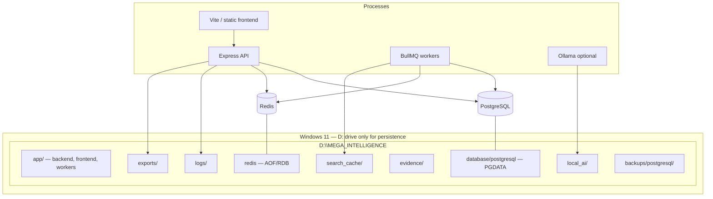
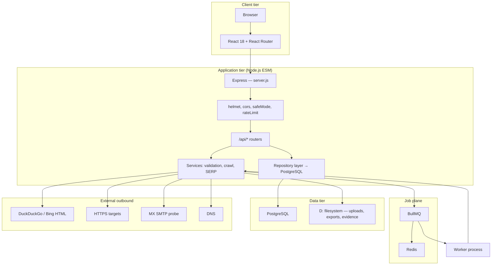
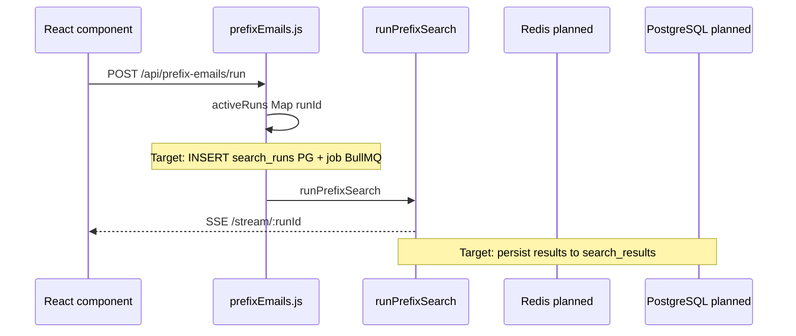
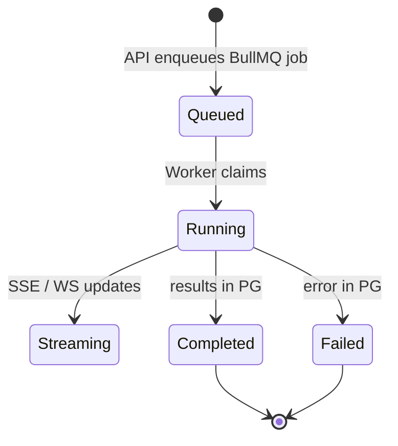

# Architecture — Flows and Diagrams

**Decision override (2026-11-22):** MEGA INTELLIGENCE uses **PostgreSQL only** on **`D:\MEGA_INTELLIGENCE`**. No MongoDB, no hybrid, no cloud DB. See [STORAGE_AND_DATABASE_DECISION.md](./STORAGE_AND_DATABASE_DECISION.md).

**Current implementation:** Still in `d:\emails` with Mongoose code **dormant** (Mongo not connected in `server.js`). Diagrams below describe **target** architecture unless labeled *as-is*.

---

## 1. Deployment topology (target)



---

## 2. Overall system architecture (target)



---

## 3. As-is vs target (data tier)

| Aspect | As-is (`d:\emails`) | Target (`D:\MEGA_INTELLIGENCE`) |
|--------|---------------------|----------------------------------|
| Primary DB | Mongoose models; **not connected** | PostgreSQL only |
| Job state | In-memory `Map` in routes | Redis + BullMQ + `search_runs` in PG |
| Uploads / logs | `backend/uploads`, `backend/logs` | `D:\MEGA_INTELLIGENCE\...` |
| Config | `Configuration` Mongo document | `app_settings` + `app_secrets` |

---

## 4. Application startup (as-is)

**Entry:** `backend/src/server.js`

| Step | Behavior |
|------|----------|
| `dotenv.config()` | Load env |
| Middleware | Helmet, CORS, safeMode (stubbed), rateLimit |
| Routes | Subset mounted — see §5 |
| `startServer()` | **Skips** `Database.connect()` — logs MongoDB disabled |
| Listen | Port **5003** (dev script) |

**Target startup (planned):**

1. Load env from `D:\MEGA_INTELLIGENCE\config`
2. `DATABASE_URL` → PostgreSQL pool (`pg` or ORM)
3. `REDIS_URL` → Redis client
4. Run pending SQL migrations
5. BullMQ workers optional separate process under `app/workers`

---

## 5. Mounted API surface (as-is)

Registered in `backend/src/server.js`:

- `/api/checks`, `/api/email-checker`, `/api/email-verification`
- `/api/prefix-emails`, `/api/phones-extract`, `/api/recruitment-phones`
- `/api/domain-emails`, `/api/whatsapp-verify`, `/api/test`

**Not mounted:** `enhancedSearch`, `companyJobs`, `industryDomains`, `file.routes`, `config.routes`, `job.routes` — persistence routes especially blocked on missing DB layer.

---

## 6. Authentication and dashboard

- JWT middleware exists (`middleware/auth.js`) but **not applied** to discovery APIs.
- **Target:** RBAC in PostgreSQL (`users`, `roles`, `api_keys`) + audit in `audit_events` — **not implemented**.

**Dashboard:** None today; **target** Intelligence Console in `app/frontend`.

---

## 7. Search request lifecycle (as-is)



**Functions:** `runPrefixSearch` in `services/prefixEmails/runSearch.js`, `SiteExplorer` in `siteExplorer.js`.

---

## 8. Data flow — contact verification (as-is)

```mermaid
sequenceDiagram
  participant UI as EmailSearchPage
  participant API as emailChecker.routes.js
  participant Svc as advancedEmailValidation.js
  participant PG as PostgreSQL planned

  UI->>API: POST /api/email-checker/run
  API->>Svc: runEmailChecks
  Svc->>Svc: DNS / SMTP probes
  Svc-->>API: results array
  API-->>UI: JSON summary
  Note over Svc,PG: Legacy emailCheck.js saves to Mongo if connected; advanced path does not persist today
```

**Target:** Optional `INSERT INTO email_checks` batch linked to `batch_jobs`.

---

## 9. Background job execution (target)



**As-is:** SSE + in-memory `Map` only (`prefixEmails.js`, `recruitmentPhones.js`, `domainEmails.js`).

---

## 10. API communication (frontend)

- **Dev:** Vite `:5173` proxies `/api` → backend (`frontend/vite.config.js`).
- **Target:** Production static build served from `app/frontend/dist`; same-origin `/api` or explicit `VITE_API_URL`.
- **Eliminate:** Hard-coded `http://localhost:5003` in components during relocation.

---

## 11. AI processing (target)

- Models stored under `D:\MEGA_INTELLIGENCE\local_ai`
- Ollama or similar — **not in current repo**; optional sidecar talking to API
- No cloud AI required; secrets in `app_secrets` if used

---

## 12. Legacy MongoDB code (preserved until migration complete)

Mongoose models remain in `d:\emails\backend\src\models\` for reference:

- `EmailCheck.js`, `Job.js`, `File.js`, `Configuration.js`
- Consumers listed in [STORAGE_AND_DATABASE_DECISION.md](./STORAGE_AND_DATABASE_DECISION.md) §3

**Do not remove** until PostgreSQL repository parity and tests pass.

---

## 13. Relocation plan (not executed)

1. Copy monorepo to `D:\MEGA_INTELLIGENCE\app\`
2. Repoint all env paths to D: subtrees
3. Introduce PostgreSQL before deleting Mongo dependencies
4. Update CI/scripts to run from new root

---

**Related:** [DATABASE_SCHEMA.md](./DATABASE_SCHEMA.md) (legacy + target PG), [DEVELOPMENT_ROADMAP.md](./DEVELOPMENT_ROADMAP.md).