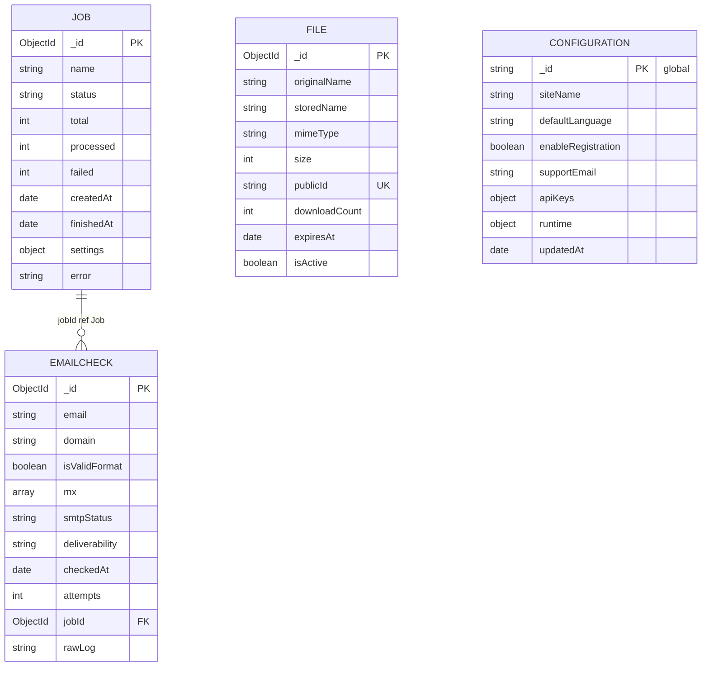

# Database Schema Audit

**Target (decision 2026-11-22):** **PostgreSQL only** on `D:\MEGA_INTELLIGENCE\database\postgresql`. No MongoDB for MEGA INTELLIGENCE. See [STORAGE_AND_DATABASE_DECISION.md](./STORAGE_AND_DATABASE_DECISION.md) for PG table design and migration plan.

**Legacy (as-is codebase):** MongoDB via Mongoose 8 in `d:\emails\backend` — models **preserved** until PG parity is approved and completed.

**Audit rule:** No database connection or queries were executed. Legacy schema derived from model files only.  
**Live data contents:** **Unknown / not verified.**

### Target PostgreSQL tables (summary)

| Table | Replaces |
|-------|----------|
| `batch_jobs` | Mongoose `Job` |
| `email_checks` | Mongoose `EmailCheck` |
| `shared_files` | Mongoose `File` |
| `app_settings` | Mongoose `Configuration` (non-secret) |
| `app_secrets` | `Configuration.apiKeys` |
| `config_audit_log` | Missing `getHistory` API |

Future MEGA tables (`companies`, `search_runs`, etc.) — see roadmap Phase 2+.

---

## 1. Overview

| Collection (Mongoose model) | File | Purpose |
|-----------------------------|------|---------|
| `emailchecks` (EmailCheck) | `models/EmailCheck.js` | Persist email validation results |
| `jobs` (Job) | `models/Job.js` | Batch validation job metadata |
| `files` (File) | `models/File.js` | File share metadata |
| `configurations` (Configuration) | `models/Configuration.js` | Singleton runtime config |

**PostgreSQL / SQL migrations:** **None** in repository.

**Migrations tooling:** None — schema is defined only in Mongoose schemas.

---

## 2. Connection behavior

- **URI resolution:** `backend/src/config/db.js` — `process.env.MONGO_URI` || `process.env.MONGODB_URI` || local default `mongodb://localhost:27017/email-checker`.
- **Runtime:** `backend/src/server.js` **does not invoke** `Database.connect()` in current `startServer()`.

---

## 3. Entity-relationship diagram (logical)

---

## 4. Model reference

### 4.1 EmailCheck (`models/EmailCheck.js`)

| Field | Type | Constraints / notes |
|-------|------|---------------------|
| `email` | String | required, lowercase, trim, **indexed** |
| `domain` | String | required, lowercase, trim |
| `isValidFormat` | Boolean | required |
| `mx` | Array of `{ priority, exchange }` | |
| `smtpBanner` | String | default null |
| `smtpStatus` | String | enum: open, closed, timeout, error |
| `deliverability` | String | enum: deliverable, undeliverable, unknown |
| `responseCode` | String | |
| `checkedAt` | Date | default now, **indexed** |
| `attempts` | Number | default 1 |
| `jobId` | ObjectId | ref `Job`, optional |
| `rawLog` | String | |
| timestamps | | `createdAt`, `updatedAt` |

**Indexes (schema-level):**

- `{ email: 1, checkedAt: -1 }`
- `{ domain: 1, checkedAt: -1 }`
- `{ jobId: 1 }`
- `{ deliverability: 1 }`

**Statics:**

- `getRecentCheck(email, hours)` — dedupe recent checks per email
- `cleanupOldRecords(days)` — delete older than cutoff (default 30 days)

**Query patterns (inferred from routes):**

- Recent check before re-validate — `check.routes.js` (when DB available)
- Batch association via `jobId`

---

### 4.2 Job (`models/Job.js`)

| Field | Type | Constraints |
|-------|------|-------------|
| `name` | String | required, trim |
| `status` | String | enum: pending, running, processing, done, failed |
| `total`, `processed`, `failed` | Number | defaults 0 |
| `createdAt` | Date | indexed |
| `finishedAt` | Date | optional |
| `settings` | Mixed | default concurrency, timeout, SMTP ports |
| `error` | String | |

**Indexes:**

- `{ status: 1, createdAt: -1 }`
- `{ name: 1 }`

**Methods:** `updateProgress`, `markAsFailed`, `start`  
**Statics:** `cleanupOldJobs(days)` — default 7 days for done/failed

**Virtuals:** `progressPercentage`, `duration`

---

### 4.3 File (`models/File.js`)

| Field | Type | Constraints |
|-------|------|-------------|
| `originalName`, `storedName`, `mimeType` | String | required |
| `size` | Number | required |
| `publicId` | String | required, **unique**, indexed |
| `downloadCount` | Number | default 0 |
| `lastDownloadedAt` | Date | |
| `expiresAt` | Date | default now + 7 days, indexed |
| `isActive` | Boolean | default true |

**Indexes:**

- `{ publicId: 1, isActive: 1 }`
- `{ expiresAt: 1 }`

**Hooks:** `pre('save')` generates `publicId` via `crypto.randomBytes(16).toString('hex')` if missing.

**Statics:** `cleanupExpiredFiles`, `getActiveFile(publicId)`

---

### 4.4 Configuration (`models/Configuration.js`)

**Design:** Single document, `_id` fixed to `"global"`, collection name `configurations`.

| Field | Type | Notes |
|-------|------|-------|
| `_id` | String | default `"global"` |
| `siteName` | String | max 100 |
| `defaultLanguage` | String | enum en, ar |
| `enableRegistration` | Boolean | placeholder |
| `supportEmail` | String | email validator |
| `apiKeys.openai`, `apiKeys.stripe` | String | `select: false` |
| `runtime.safeMode` | Boolean | |
| `runtime.maintenanceMode` | Boolean | |
| `runtime.logLevel` | String | enum error, warn, info, debug |
| `runtime.rateLimitRPS` | Number | 1–1000 |
| `updatedAt` | Date | manual |

**Statics:** `getCurrent`, `getDefaultConfig`, `updateConfig`, `getPublicConfig` (redacts keys)

**No foreign keys** — standalone singleton.

---

## 5. Duplicate detection

| Domain | Mechanism |
|--------|-----------|
| Email checks | `getRecentCheck` within time window |
| API batch input | Array dedupe in `emailChecker.routes.js` |
| Search orchestrators | `Set` for URLs, email pairs, phones (in-memory) |
| Files | `publicId` unique index |
| Intelligence entities | **Not modeled** |

---

## 6. Data retention

| Data | Retention (code) | Trigger |
|------|------------------|---------|
| EmailCheck | 30 days | `EmailCheck.cleanupOldRecords(30)` in `server.js` `runCleanupTasks` |
| Job | 7 days (done/failed) | `Job.cleanupOldJobs(7)` |
| File | Soft-deactivate after `expiresAt` | `File.cleanupExpiredFiles` |
| Search run results | None persisted | ephemeral |

Cleanup runs only if `mongoose.connection.readyState === 1`.

---

## 7. Backup procedures

- **In application code:** None.
- **Documentation:** `DEPLOYMENT.md` may describe ops backups — **not verified as automated in repo**.

---

## 8. Performance and scalability issues

| Issue | Impact |
|-------|--------|
| Mongo disabled in production entry path | No historical analytics or dedupe at scale |
| No sharding / read replicas in code | Single connection design |
| Heavy write volume from batch SMTP checks | Index on `email` + `checkedAt` helps; no TTL index — relies on cleanup job |
| No search/investigation collections | All OSINT results lost on refresh |
| Singleton Configuration | Hot document for all config reads — acceptable at small scale |
| In-memory search caches | No shared cache across processes |

**SQL injection:** N/A (MongoDB). **NoSQL injection:** Depends on query construction — routes use Mongoose models with typed fields (low risk for modeled paths).

---

## 9. Missing schemas for MEGA INTELLIGENCE

Not present in codebase (required for target platform):

- `companies`, `contacts`, `investigations`, `sources`, `search_runs`, `audit_events`, `threat_indicators`, `entities` (resolution graph)

---

**End of database schema audit.**