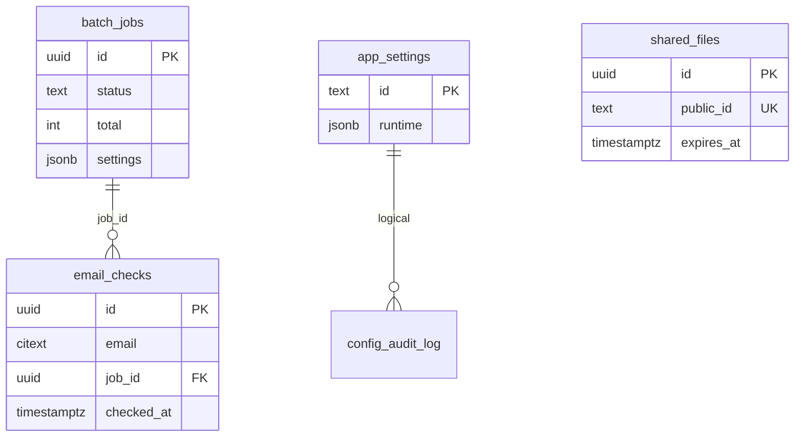

# Final Storage & Database Architecture Decision

**Status:** Approved direction for MEGA INTELLIGENCE (planning only — **not implemented**).  
**Overrides:** All prior MongoDB-first or hybrid storage recommendations in audit docs.  
**Current codebase location:** `d:\emails` (unchanged until relocation is approved).  
**Target root:** `D:\MEGA_INTELLIGENCE`

---

## 1. Project root layout (target)

All application and persistent data on **D:** — nothing persistent on **C:**.

```
D:\MEGA_INTELLIGENCE\
├── app\                      # Source (backend, frontend, workers) — post-relocation
├── config\                   # Non-secret config templates; secrets via env/OS store
├── database\
│   └── postgresql\           # PGDATA (bind mount / native data_directory)
├── backups\
│   └── postgresql\           # pg_dump / physical backup artifacts
├── exports\                  # User/system exports (CSV, JSON, reports)
├── logs\                     # Application + worker logs
├── evidence\                 # Investigation evidence (hash-stamped, policy-bound)
├── search_cache\             # Optional file-backed cache; hot cache in Redis
├── local_ai\                 # Ollama models / weights (when enabled)
├── redis\                    # Optional: Redis persistence (RDB/AOF) on D:
└── docker\                   # Compose files; volumes → D: paths only
```

**Verified (2026-11-22):**

| Check | Result |
|-------|--------|
| `D:\` available | Yes (NTFS) |
| Free space | ~**434 GiB** (`SizeRemaining` ≈ 466 GB) |
| `D:\MEGA_INTELLIGENCE` | **Does not exist** — safe to create when approved (no overwrite risk today) |

**Not verified (requires approval before ops):**

- NTFS permissions for service account / Docker user on `D:\MEGA_INTELLIGENCE`
- Persistence after reboot (Windows service + Docker restart policies)
- Whether any legacy MongoDB data exists on this machine (not audited; no mongod data path inspected)

---

## 2. Database decision

| Rule | Detail |
|------|--------|
| **Single database** | **PostgreSQL only** for MEGA INTELLIGENCE |
| **No MongoDB** | Do not install MongoDB, create `data/db` dirs, or use Atlas |
| **No hybrid** | No dual-write Mongo + PostgreSQL |
| **No cloud DB** | Local PostgreSQL on D: only |
| **Legacy code** | Keep existing Mongoose models in `d:\emails` until migration approved and completed |

**Redis:** Job queues (BullMQ), session/cache, rate-limit shared state — persistence on `D:\MEGA_INTELLIGENCE\redis` (or Docker volume).

---

## 3. Mongoose / MongoDB dependency audit

### 3.1 NPM dependency

- `mongoose` — `backend/package.json` (v8.x)

### 3.2 Models (collections)

| Model | File | Mongo collection | PK type |
|-------|------|-------------------|---------|
| EmailCheck | `backend/src/models/EmailCheck.js` | emailchecks | ObjectId |
| Job | `backend/src/models/Job.js` | jobs | ObjectId |
| File | `backend/src/models/File.js` | files | ObjectId |
| Configuration | `backend/src/models/Configuration.js` | configurations | String `_id: global` |

### 3.3 Relationships (logical)

- `EmailCheck.jobId` → `Job._id` (optional FK)

### 3.4 Routes and services using Mongoose

| Consumer | File | Models / usage |
|----------|------|----------------|
| HTTP entry / cleanup | `server.js` | EmailCheck, Job, File — `cleanupOldRecords`, `cleanupOldJobs`, `cleanupExpiredFiles`; `mongoose.disconnect` |
| DB connector | `config/db.js` | `mongoose.connect` (not called from current `startServer`) |
| Config service | `services/configService.js` | Configuration — get/update/safe mode |
| Email check (legacy path) | `services/emailCheck.js` | EmailCheck, Configuration — save results, recent check |
| Safe mode service | `services/safeMode.js` | Configuration — imports mongoose but uses Configuration only |
| Checks API | `routes/check.routes.js` | EmailCheck, Configuration — history/stats aggregates |
| Batch jobs API | `routes/job.routes.js` | Job — CRUD, batch progress (**unmounted**) |
| Files API | `routes/file.routes.js` | File, Configuration (**unmounted**) |
| Config API | `routes/config.routes.js` | Configuration — calls `getHistory`, `resetToDefault` (**methods missing on model** — broken) |
| Config API (alt) | `routes/config.js` | Dynamic mongoose import for health |
| Seed script | `scripts/seedConfig.js` | Configuration |
| Tests | `tests/setup.js`, integration tests | `MONGO_URI` test DB |

### 3.5 What does **not** use Mongo today (important)

- `advancedEmailValidation.js` / `POST /api/email-checker/run` — **no persistence** (primary UI path)
- Prefix/recruitment/domain search — in-memory `Map` + SSE only
- BullMQ — dependency present, **no implementation**

---

## 4. PostgreSQL schema design (parity + platform)

**Convention:** `uuid` PKs, `timestamptz`, `jsonb` for flexible blobs, `citext` for emails where enabled.

### 4.1 Phase A — Parity tables (replace Mongoose)

#### `batch_jobs` (replaces `Job`)

| Column | Type | Notes |
|--------|------|-------|
| id | uuid PK | default `gen_random_uuid()` |
| name | text NOT NULL | |
| status | text NOT NULL | CHECK in (pending, running, processing, done, failed) |
| total, processed, failed | int | default 0 |
| settings | jsonb | concurrency, timeouts, ports |
| error | text | |
| created_at, updated_at, finished_at | timestamptz | |

Indexes: `(status, created_at DESC)`, `(name)`.

#### `email_checks` (replaces `EmailCheck`)

| Column | Type | Notes |
|--------|------|-------|
| id | uuid PK | |
| email | citext NOT NULL | |
| domain | text NOT NULL | |
| is_valid_format | boolean NOT NULL | |
| mx | jsonb | |
| smtp_banner, smtp_status, response_code | text | |
| deliverability | text NOT NULL | CHECK enum-like |
| checked_at | timestamptz NOT NULL | |
| attempts | int | default 1 |
| job_id | uuid REFERENCES batch_jobs(id) ON DELETE SET NULL | |
| raw_log | text | |
| created_at, updated_at | timestamptz | |

Indexes: `(email, checked_at DESC)`, `(domain, checked_at DESC)`, `(job_id)`, `(deliverability)`.

#### `shared_files` (replaces `File`)

| Column | Type | Notes |
|--------|------|-------|
| id | uuid PK | |
| original_name, stored_name, mime_type | text NOT NULL | |
| size_bytes | bigint NOT NULL | |
| public_id | text UNIQUE NOT NULL | hex token |
| download_count | int default 0 | |
| last_downloaded_at, expires_at | timestamptz | |
| is_active | boolean default true | |
| created_at, updated_at | timestamptz | |

Indexes: `(public_id, is_active)`, `(expires_at)`.

Filesystem binary path (not in DB): `D:\MEGA_INTELLIGENCE\app\uploads\` or dedicated `storage\files\`.

#### `app_settings` (replaces singleton `Configuration`)

**Option (recommended):** single row + jsonb sections

| Column | Type | Notes |
|--------|------|-------|
| id | text PK | fixed `'global'` |
| site_name, default_language, support_email | text | |
| enable_registration | boolean | |
| runtime | jsonb | safe_mode, maintenance, log_level, rate_limit_rps |
| updated_at | timestamptz | |

#### `app_secrets` (sensitive — replaces `apiKeys` with select:false)

| Column | Type | Notes |
|--------|------|-------|
| id | serial PK | |
| key_name | text UNIQUE | openai, stripe, whatsapp, etc. |
| secret_ciphertext | bytea | encrypt with DPAPI or env master key |
| updated_at | timestamptz | |

#### `config_audit_log` (new — fixes missing `getHistory`)

| Column | Type |
|--------|------|
| id | bigserial PK |
| changed_by | text |
| patch | jsonb |
| created_at | timestamptz |

### 4.2 Phase B — MEGA INTELLIGENCE tables (post-parity)

Proposed (not in current code): `companies`, `contacts`, `search_runs`, `search_results`, `investigations`, `investigation_events`, `sources`, `audit_events`, `threat_indicators`, `entity_links`.

Details deferred to Phase 2+ in [DEVELOPMENT_ROADMAP.md](./DEVELOPMENT_ROADMAP.md).

### 4.3 ER diagram (target)



---

## 5. Migration strategy (requires explicit approval)

### Principles

1. **Do not delete** Mongoose code or Mongo data during planning or Phase 0.
2. **No MongoDB install** on D: for the new platform.
3. **Cutover:** PostgreSQL becomes authoritative in one approved release — no hybrid dual-write unless explicitly re-approved (currently forbidden).
4. **Relocate:** Copy/evolve `d:\emails` → `D:\MEGA_INTELLIGENCE\app` when approved.

### Steps (planned)

| Step | Action | Approval gate |
|------|--------|----------------|
| M0 | Create `D:\MEGA_INTELLIGENCE` tree; document permissions | Ops approval |
| M1 | Install PostgreSQL with `data_directory = D:\MEGA_INTELLIGENCE\database\postgresql` | Ops approval |
| M2 | Add migration tool (e.g. `node-pg-migrate` or Drizzle) under `app/backend` | Dev approval |
| M3 | Implement **repository layer** (`repositories/`) mirroring model statics/methods | Dev approval |
| M4 | Wire `configService`, `emailCheck`, routes to repositories; feature-flag `DATABASE_URL` | Dev approval |
| M5 | Mount orphaned routes only after persistence works | Dev approval |
| M6 | Redis + BullMQ: move `activeRuns` to Redis keys with TTL | Dev approval |
| M7 | Repoint uploads/logs to D: paths via env | Ops approval |
| M8 | **Optional** — if legacy MongoDB has production data: one-time ETL `mongoexport` → transform → `COPY` into PG | **Separate approval**; skip if no data |
| M9 | Deprecate Mongoose imports behind adapter; remove only after parity tests pass | Dev approval |

### Preserving functionality checklist

| Feature | Mongoose today | PostgreSQL target |
|---------|----------------|-------------------|
| Save email check | `emailCheck.saveEmailCheck` | INSERT `email_checks` |
| Recent check dedupe | `getRecentCheck` | SELECT WHERE email AND checked_at > … |
| Batch job progress | `Job.updateProgress` | UPDATE `batch_jobs` |
| File share metadata | `File` model | `shared_files` + disk on D: |
| Runtime config / safe mode | `Configuration.getCurrent` | `app_settings` + Redis cache |
| Cleanup jobs | server hourly | pg_cron or BullMQ scheduled job |
| Config history | **broken** `getHistory` | `config_audit_log` |

### Testing requirements (pre-cutover)

- Jest: replace in-memory Mongo tests with **testcontainers PostgreSQL** or local `postgresql://` test DB on D:
- Parity integration: batch job + email check + file upload round-trip
- Restart test: data survives PG restart and Windows reboot

---

## 6. Backup and recovery

| Item | Location | Procedure (planned) |
|------|----------|-------------------|
| Logical backup | `D:\MEGA_INTELLIGENCE\backups\postgresql` | `pg_dump -Fc` daily; retention policy TBD |
| WAL / PITR | Same subtree | Optional `archive_mode` to `backups\postgresql\wal` |
| Redis | `backups\redis` | RDB snapshots |
| Evidence / exports | `backups\evidence` | Filesystem snapshot or robocopy |
| Recovery drill | Document in `docs/RUNBOOK.md` (future) | Quarterly restore to empty PG instance |

---

## 7. Docker on Windows 11 (D: volumes only)

Example volume bindings (illustrative — not deployed):

```yaml
# All named volumes or binds must use D:\MEGA_INTELLIGENCE\...
volumes:
  pgdata:
    driver: local
    driver_opts:
      type: none
      o: bind
      device: D:\MEGA_INTELLIGENCE\database\postgresql
```

- `DATABASE_URL=postgresql://...@localhost:5432/mega_intelligence`
- `REDIS_URL=redis://localhost:6379` with `dir` / volume on D:

---

## 8. Safety constraints (confirmed for planning)

- Will **not** overwrite existing data without approval
- Will **not** migrate/delete legacy databases without approval
- Will **not** install MongoDB for MEGA INTELLIGENCE
- Will **not** implement until explicit sign-off on this document + roadmap phases

---

## 9. Approval checklist

- [ ] Create `D:\MEGA_INTELLIGENCE` directory tree
- [ ] PostgreSQL data directory on D:
- [ ] Repository migration M3–M5
- [ ] Relocation from `d:\emails`
- [ ] Optional Mongo ETL (only if data exists)
- [ ] Mongoose removal (final step only)

---

**Next:** Review [ARCHITECTURE.md](./ARCHITECTURE.md) and [DEVELOPMENT_ROADMAP.md](./DEVELOPMENT_ROADMAP.md) for phased execution.